# Taskbar Tiles

Small live tiles on the Windows taskbar, next to your app icons: what's playing, your Claude usage, CPU and memory, device batteries, the clock, or a tiny pixel farm that follows the real sunrise. Hover a tile for details, click it to act, and add your own tiles with a script or a .NET plugin.

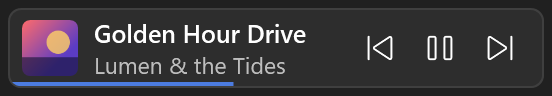
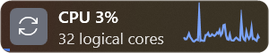
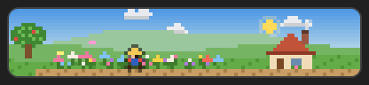

Made for Windows 11 (64-bit).

## Install

1. Download `TaskbarTiles-<version>-win-x64.zip` from the [latest release](https://github.com/daniel-skalik/taskbar-tiles/releases/latest).
2. Unzip it anywhere.
3. Double-click `install.cmd`.

That's it: no .NET to install first. The app is copied to `%LOCALAPPDATA%\TaskbarTiles\app`, starts, and starts again when you sign in (a `TaskbarTiles` shortcut in your Startup folder). Nothing needs admin rights.

The app is not code-signed, so Windows may warn before running `install.cmd` or the app the first time ("Windows protected your PC"). Choose **More info**, then **Run anyway**. If you'd rather not, build it yourself from source (below).

## Tiles

| | |
|---|---|
|  | **Media**<br>Now playing in any app with media controls (or the ones you pick, such as Spotify), with playback buttons. |
| 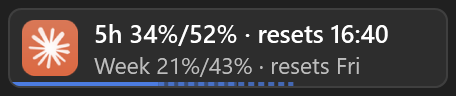 | **Claude usage**<br>Your Claude plan's 5-hour and weekly limits, and how much an even pace would have used by now. |
|  | **System monitor**<br>CPU, memory, GPU, network and every drive, one at a time with a chart, or all at once. |
| 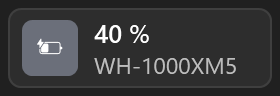 | **Device batteries**<br>The lowest battery of your mouse, keyboard and headphones. |
| 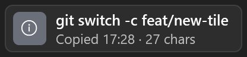 | **Clipboard peek**<br>The last thing you copied; click for recent copies to copy again. |
| 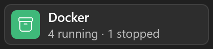 | **Docker**<br>How many containers run; click for each one's status. |
| 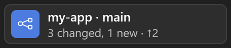 | **Git repository**<br>A repository's branch, changes, and how far it is ahead of or behind its upstream. |
| 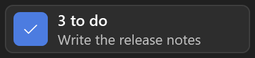 | **To do**<br>Tasks from a Markdown file; tick them off and add new ones from the popup. |
| 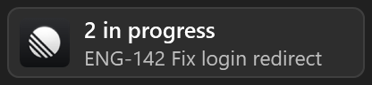 | **Linear**<br>Your issues in In Progress and Todo; click one to open it. |
| 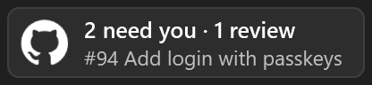 | **GitHub pull requests**<br>Pull requests waiting for your review, yours that are blocked, need you or wait for others, and recent GitHub Actions runs. |
| 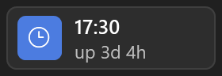 | **Clock and uptime**<br>The time, and how long Windows has been up. |
| 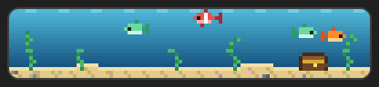 | **Aquarium**<br>Fish and bubbles; click to feed them. |
|  | **Cozy farm**<br>A farm that follows your clock and the real sunrise and sunset. |
| 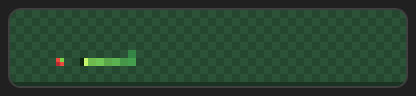 | **Snake**<br>A snake that plays itself; click to start over. |
| 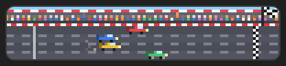 | **Racers**<br>Pixel cars race; click for a new race. |

The pictures use made-up sample data; `dotnet run --project tools/screenshots` draws them again.

## Use

- **Add a tile:** the **+** button at the end of your tiles. Tiles are grouped in folders, for example **Fun** or **Dev**.
- **Details:** click a tile for its popup, with actions and a ⚙ for its settings (also right-click › **Settings…**).

  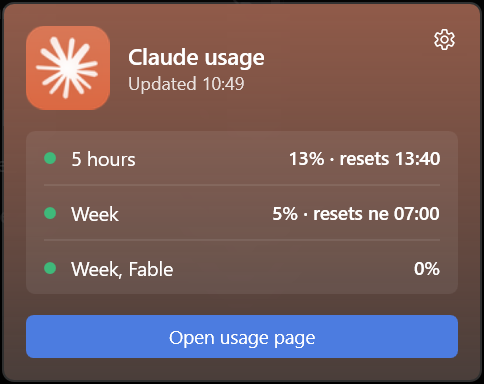

- **Move or remove tiles:** right-click a tile › **Edit layout**, then drag tiles or click their ×. Right-click › **Create stack…** puts several tiles in one slot.
- **Exit:** right-click a tile › **More** › **Exit Taskbar Tiles**.


Your layout and settings live in `%LOCALAPPDATA%\TaskbarTiles\config.json`. You rarely need to touch it, but it's all described in [docs/configuration.md](docs/configuration.md). To write your own tile with a PowerShell (or any) script, see [docs/script-connectors.md](docs/script-connectors.md).

## Make your own tile

A tile is a folder with a `tile.json` and a script (or a .NET DLL), described in [docs/script-connectors.md](docs/script-connectors.md). With an AI coding agent such as Claude Code, open this repository and ask for the tile you want ("a tile that shows my GitHub notifications"): the [new-tile skill](.claude/skills/new-tile/SKILL.md) walks it through writing, checking and installing it. To check a tile folder yourself:

```bat
dotnet run --project tools/screenshots -- --preview my-tiles\my-tile
```

It runs the script as the app would, lists any problems and renders the tile to a PNG.

## Update

Download the new release and run its `install.cmd`. It replaces the app and the bundled tiles. Your config, logs and your own tiles are kept.

## Uninstall

Run `uninstall.cmd` from the release zip (or the repository). It stops the app, removes it and its Startup shortcut, and keeps your config, logs and tiles so a later install picks them up. To remove those too:

```bat
uninstall.cmd -RemoveSettings
```

## Build from source

Needs the [.NET 9 SDK](https://dotnet.microsoft.com/download/dotnet/9.0) and Git.

```bat
git clone https://github.com/daniel-skalik/taskbar-tiles.git
cd taskbar-tiles
install.cmd
```

In the repository `install.cmd` builds the app first, then installs it the same way. Run it again after `git pull` to update. Tests: `dotnet test`.

To make a release zip yourself: `powershell -ExecutionPolicy Bypass -File tools\package.ps1 -Version 1.0.0` (written to `artifacts\package`). Pushing a tag such as `v1.0.0` makes GitHub build it and publish the release.
